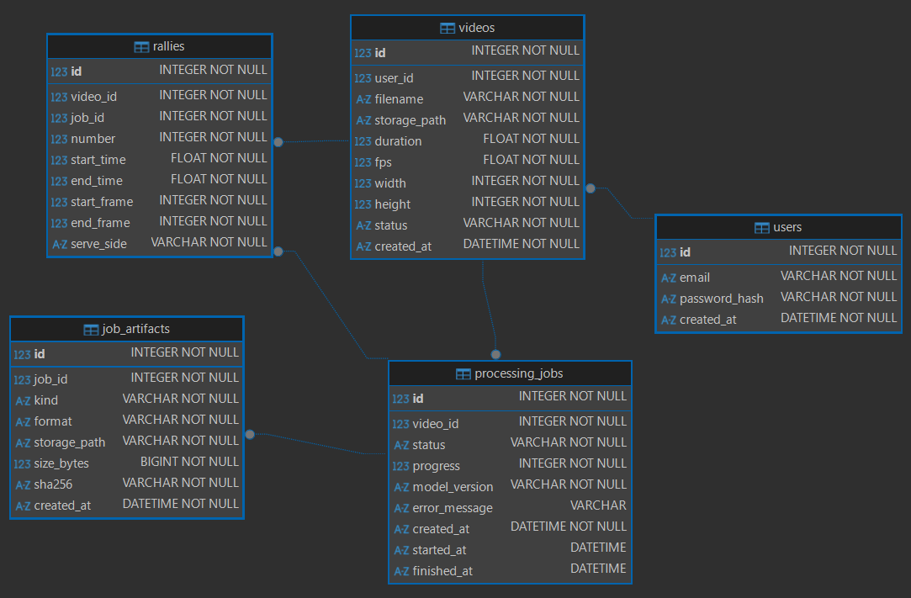

# Volleyball Tracking

Сервис для анализа видео волейбольных матчей. Нейросеть находит игроков и мяч, отслеживает их движение, выделяет розыгрыши (rally) и определяет сторону подачи (`near` или `far`).

## Схема БД

Тип БД: реляционная, SQLite для разработки. Модели написаны на SQLAlchemy 2.0, схема версионируется через Alembic.



Основные таблицы:

- `users` — пользователи, пароль хранится только как хеш.
- `videos` — загруженные видео и их технические параметры (длительность, fps, размер кадра).
- `processing_jobs` — запуски обработки видео. Перезапуск создаёт новую запись, история сохраняется.
- `rallies` — найденные розыгрыши с номером, временем, кадрами и стороной подачи.
- `track_data` — ссылки на файлы с сырыми результатами нейросети (Parquet/CSV).
- `alembic_version` — служебная таблица Alembic с версией схемы.

## Архитектура и пайплайн обработки

Видео загружается через приложение, файл сохраняется в папку с исходниками, а в БД создаётся запись в `videos` со статусом `uploaded`. Затем создаётся задача в `processing_jobs` со статусом `queued`.

Обработка видео разбита на независимые шаги (скрипты в папке `app/analysis`):

1. **`detect.py`** — прогоняет видео через YOLO. Сохраняет все детекции в `detections.csv` (кадр, класс, координаты, уверенность) и технические параметры в `meta.json`.
2. **`trajectory.py`** — вспомогательный модуль. Строит из сырых детекций траекторию мяча, отбрасывая шум и короткие пропуски.
3. **`segment.py`** — читает траекторию и на основе скорости мяча и временных интервалов выделяет розыгрыши. Результат сохраняется в `rallies.json`.
4. **`evaluate.py`** — (опционально) сравнивает автоматически найденные розыгрыши с ручной разметкой (`manual.json`), считает метрики Precision/Recall/F1 и позволяет подобрать оптимальные параметры.

Воркер (или разработчик вручную) берёт задачу, переводит её в `processing` и запускает эти скрипты. Сырые детекции сохраняются в файл (Parquet/CSV), а в `track_data` записывается путь к файлу. Итоговые розыгрыши записываются в таблицу `rallies`. После этого задача получает статус `completed`. Если обработка падает, задача получает статус `error` с текстом ошибки в `error_message`.

### Обходной путь для Windows (Кириллица в путях)
Библиотека OpenCV (`cv2`) на Windows плохо работает с путями, содержащими русские буквы. В `detect.py` реализован обходной путь: если OpenCV не может открыть видео напрямую, Python считывает файл в память с помощью `numpy`, и уже оттуда передает байты в OpenCV.

## Структура проекта

```text
app/                  # подключение к БД (db.py) и ORM-модели (models.py)
├── analysis/         # скрипты для компьютерного зрения
│   ├── detect.py     # шаг 1: детекция YOLO
│   ├── trajectory.py # шаг 2: построение траектории
│   ├── segment.py    # шаг 3: поиск розыгрышей
│   ├── evaluate.py   # шаг 4: оценка точности
│   └── params.yaml   # параметры алгоритма
migrations/           # миграции Alembic
storage/              # видео и результаты нейросети (не в git)
ERD.png               # схема БД
```

## Запуск БД

```bash
pip install sqlalchemy alembic
py -m alembic upgrade head
```

Команда создаёт файл базы данных (например, `video_analytics.db`) в корне проекта. Изменения схемы делаются новой миграцией: `py -m alembic revision --autogenerate -m "описание"`.

## Запуск анализа видео

Перед запуском убедитесь, что установлены зависимости для нейросети:
```bash
py -m pip install opencv-python ultralytics pyyaml
```

Все команды выполняются из папки `app/analysis`:

**1. Детекция (YOLO):**
```bash
cd app/analysis
py detect.py
# или с явным указанием путей:
py detect.py --video "путь\к\видео.mp4" --weights "путь\к\весам.pt" --out data\match1
```

**2. Поиск розыгрышей:**
```bash
py segment.py --data data\match1 --out data\match1\rallies.json
```

**3. (Опционально) Оценка точности:**
```bash
py evaluate.py --cases data --params params.yaml --out grid_results.csv
```

## Хранение результатов нейросети

Нейросеть на одном матче (2 часа, 30 fps) даёт около 216 000 кадров. При 13 объектах в кадре это примерно 2,8 млн детекций. Ниже три варианта хранения, оценки объёма приблизительные.

| Вариант | Плюсы | Минусы |
|---|---|---|
| **1. Все детекции в SQLite** | Один источник данных, произвольные SQL-запросы | Около 200–300 МБ на матч, блокировки при параллельной записи, тяжёлое удаление и резервное копирование |
| **2. JSON/CSV + ссылки из БД** | Дешёвая запись, данные вне БД, версии по запускам | JSON сильно раздувается и медленно парсится, CSV не типизирован, нельзя выбрать данные без чтения всего файла |
| **3. Только итоговые Rally в БД** | Самая маленькая БД, простые запросы и статистика | Сырые данные не сохраняются: любая правка логики розыгрышей или новый детектор требуют повторного прогона нейросети на GPU |

## Обоснованный выбор

Выбран гибридный вариант: **реляционная БД для бизнес-сущностей** (пользователи, видео, розыгрыши) и **файлы (Parquet/CSV) для сырых детекций**.

Розыгрыши, задачи и метаданные нужны для списков, фильтрации и статистики, поэтому они лежат в БД (таблица `rallies`). 

Сырые детекции записываются один раз и обычно читаются целиком по видео или по диапазону кадров. Для такого доступа файл эффективнее строк в таблице: Parquet сжат примерно в десятки мегабайт на матч, хранит типы и позволяет читать только нужные группы строк. В таблице `track_data` мы храним только путь к этому файлу.

Вариант 1 отклонён. Большая часть запросов читает детекции целиком или по одному розыгрышу, поэтому SQL-выборки по отдельным детекциям почти не нужны. Миллионы строк при этом замедляют записи, требуют блокировок SQLite и тяжело переносятся при переобработке.

Вариант 3 в чистом виде отклонён из-за потери данных. Сохранение сырых детекций позволяет пересчитать розыгрыши без повторного запуска нейросети, отлаживать ошибки и показывать траекторию мяча.

Каждый результат привязан к `processing_jobs.model_version`, поэтому результаты разных версий модели можно сравнивать. Если позже понадобится аналитика по детекциям, данные можно загрузить в PostgreSQL или ClickHouse без изменения моделей розыгрышей.